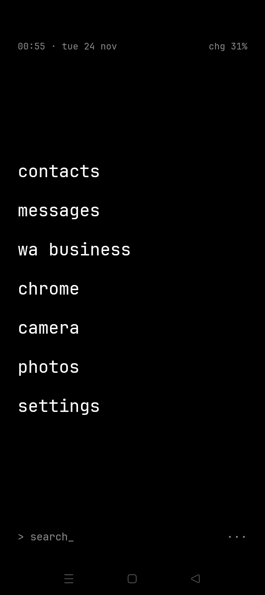

# mono

**A black-and-white, text-only Android home screen.** No icons, no widgets, no colour: just your apps as plain words in JetBrains Mono, a status line, and fast search. Styled after a Sway / Waybar / Wofi Linux desktop.

<p align="center"></p>

- **Tiny:** about 165 KB. No internet access, nothing running in the background.
- **Safe to try:** installing changes nothing. You turn it on, and off again, from one switch.
- **Android 10 or newer.** Tested on an OPPO A17 (ColorOS 12 / Android 12).

---

## Install (2 minutes)

1. **Download** `mono-v*.apk` from the [latest release](../../releases/latest) on your phone.
2. **Open the file.** If Android asks, allow your browser or file manager to *install unknown apps*. Google Play Protect may warn that it doesn't know the developer; choose **Install anyway**. mono isn't on the Play Store.
3. **Open "mono"** from your app list and tap **turn on**, then **Set as default**.

That's it. Press Home and you're in mono.

## Turn it off or remove it

- **Off:** open **mono** from your app list → **turn off**, or `···` → *turn off mono*. Your phone's own home screen comes straight back.
- **Remove:** turn it off first, then Settings → Apps → mono → Uninstall.

## Using mono

```
 14:32 · tue 24 nov                     bat 87%

   phone
   messages
   chrome
   camera

 > search_                                  ···
```

| Do this | To |
|---|---|
| tap an app | open it |
| hold an app | move, rename, unpin, hide, app info |
| swipe **up** or tap `> search_` | all apps + search |
| swipe **down** | pull down notifications |
| swipe **left** / **right** | open an app you choose (default: camera / phone) |
| tap the time / battery | alarms / battery settings |
| tap `···` | menu and settings |

**Search** works like Wofi. Type, and the best match is marked `>`; press Enter to open it. When only one app matches, it opens on its own (you can turn that off). Matching uses name starts, **initials** (`gm` → google maps), word starts, then anywhere, with apps you use most ranked first. Hidden apps leave the list but are still found by search. If nothing matches, **search web** sends the text to your browser.

**Settings** (`···` → settings):
- status bar on mono's screen: hidden / shown
- clock: line / big / off
- text size: small / medium / large
- align: left / center / right
- auto-open single match
- app list order: a–z / most used
- swipe left / right app
- black & white and system icons (see below)

## Optional: black & white phone

While mono is on, it can also:
- **black & white:** turn the **whole phone grayscale**
- **quiet system icons:** hide alarm, mute, Bluetooth, hotspot, location and similar status-bar icons in every app

Turning mono off puts both back exactly as they were.

Android only lets a **computer** allow this, once:

1. On the phone, turn on **Developer options** (Settings → About phone → tap *Build number* 7 times), then **USB debugging**.
   - **OPPO / realme / OnePlus (ColorOS):** also turn on **Disable permission monitoring** in Developer options, then **restart the phone**.
   - **Xiaomi (MIUI / HyperOS):** also turn on **USB debugging (Security settings)**.
2. On the computer, install [Android platform-tools](https://developer.android.com/tools/releases/platform-tools), plug in the phone, accept the prompt, and run:
   ```
   adb shell pm grant com.nilupul.mono android.permission.WRITE_SECURE_SETTINGS
   ```
3. Press Home. Switch either option in `···` → settings.

You can turn the extra developer switches off again afterwards; the permission stays.

Don't want a computer? Switch grayscale by hand: Settings → Accessibility → Color correction → Grayscale.

## Privacy & security

| | |
|---|---|
| Internet | **none**: mono has no internet permission, so nothing can leave the phone |
| Background | none: no services, no scheduled jobs, no boot receivers |
| What it stores | your pins, renames, hidden apps, settings and launch counts, in its private storage only; never backed up (`allowBackup="false"`) |
| Permissions | `EXPAND_STATUS_BAR` (pull down notifications). Optional `WRITE_SECURE_SETTINGS`, only if you grant it from a computer, used for exactly two settings (grayscale and the status-bar icon list), each restored on turn-off |
| Left out on purpose | double-tap to lock (needs an Accessibility service), unread-notification highlights (notification access), screen time (usage access), contact search (contacts) |

If you granted the optional permission, **turn mono off before uninstalling it**. Android gives apps no warning before removal, so mono can't restore your settings afterwards. Details and manual undo steps are in [SECURITY.md](SECURITY.md).

## Build from source

No Gradle, no Android Studio. The scripts call the Android SDK tools directly (aapt2 → javac → d8 → zipalign → apksigner).

Requires the Android SDK (platforms, build-tools, platform-tools) and JDK 17+.

```bash
./build.sh              # Linux / macOS / Git Bash  -> build/mono.apk
./build.sh --install    # build + adb install -r
```
```powershell
.\build.ps1             # Windows PowerShell
.\build.ps1 -Install
```

The first build creates your own signing key in `keystore/` (git-ignored). **Back it up:** Android only installs updates signed with the same key. An APK you build yourself can't update one from the Releases page, and vice versa; uninstall first.

```
AndroidManifest.xml      permissions; HomeActivity ships disabled
src/com/nilupul/mono/
  Apps.java              app list, saved choices, font, on/off, system looks
  HomeActivity.java      home screen, gestures, search, settings
  SwitchActivity.java    the "mono" on/off screen in the app list
  Ui.java                mono-style pop-ups
res/                     black theme, ">_" icon
assets/                  JetBrains Mono Regular + its licence
build.sh / build.ps1     build scripts
```

## Credits & licence

- Code: [MIT](LICENSE) © 2026 Nilupul Nishan.
- Font: [JetBrains Mono](https://www.jetbrains.com/lp/mono/), SIL Open Font License 1.1 (`assets/JetBrainsMono-OFL.txt`).
- Behaviour inspired by Olauncher, mLauncher, Last Launcher, MinimalSF, Slate and YAM Launcher.
